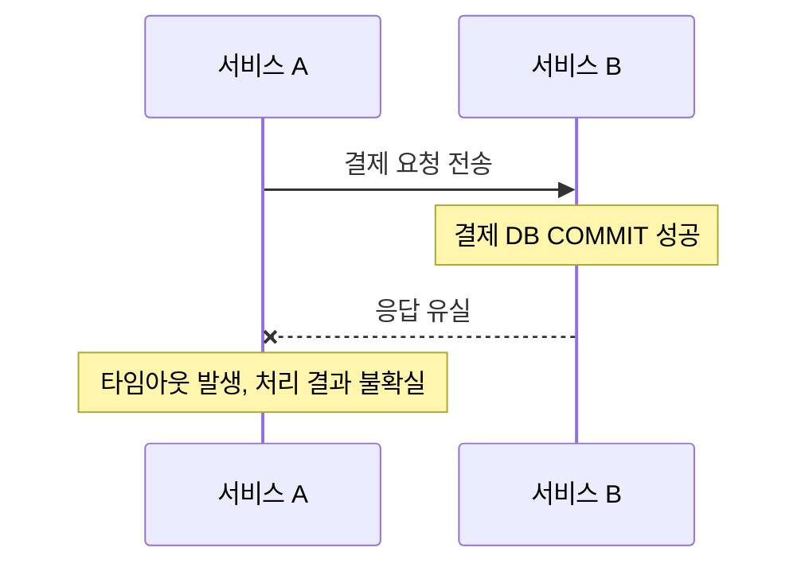

# 부분 장애

부분 장애는 분산시스템을 구성하는 여러 컴포넌트 중 일부에 장애가 발생하더라도 나머지는 정상적으로 동작하는 현상이다.

## 분산시스템의 한계

네트워크 요청은 요청 전송부터 업무 처리, 응답 수신까지 하나의 원자적 작업으로 묶이지 않는다. 따라서 상대 서비스가 작업을 완료했더라도 호출자는 그 결과를 확인하지 못할 수 있다.



**타임아웃은 작업 실패의 증거가 아니라, 정해진 시간 안에 결과를 받지 못했다는 의미다.**

| 상황 | 서비스 B의 실제 결과 | 서비스 A가 확인한 것 |
| --- | --- | --- |
| 요청이 B에 도착하지 못함 | 처리되지 않음 | 타임아웃 |
| B가 요청을 받아 처리 중 | 성공 여부 미확정 | 타임아웃 |
| B가 DB COMMIT 후 응답 유실 | 처리 성공 | 타임아웃 |
| B의 DB 작업이 롤백된 후 응답 유실 | 처리 실패 | 타임아웃 |

타임아웃이 발생하면 요청 ID로 업무 결과를 확인해야 한다. 결과가 불확실하다면 멱등성 계약에 따라 동일한 멱등 키로 재시도하거나, 처리를 보류한 뒤 재조회·대사해야 한다.

## 부분 장애의 유형

### 프로세스 장애

작업 처리 중 JVM이 종료되는 것처럼, 서비스의 프로세스가 강제로 종료되는 상황이다.

- DB COMMIT 전에 프로세스가 종료되어 연결이 닫히면, 미커밋 DB 변경은 일반적으로 롤백된다.
- DB COMMIT 후 응답 전에 종료되면, 커밋된 업무 결과는 남지만 호출자는 성공을 확인하지 못할 수 있다.
- 메모리에만 저장한 상태는 프로세스 종료와 함께 사라진다.

따라서 장애가 DB COMMIT 전후 중 어느 시점에 발생했는지 확인해야 한다.

### 네트워크 분할

서비스 자체는 실행 중이지만 서로 통신할 수 없는 상태다. 예를 들어 두 서비스가 서로 다른 서버에 있을 때, 각 서버는 정상이지만 서버 사이의 네트워크가 끊길 수 있다.

서버를 재시작하기 전에 DNS, 방화벽, 라우팅, 포트, 로드밸런서와 상대 서비스의 상태를 점검한다. 복구 전에는 타임아웃, 제한적 재시도, 호출 차단·업무 보류를 통해 장애 확산과 잘못된 쓰기를 방지한다.

### 지연 장애

서비스가 종료되지는 않았지만 응답이 지나치게 느린 상황이다.

타임아웃 직후 같은 요청을 재시도하면, 기존 요청이 여전히 처리 중일 수 있으므로 중복 처리가 발생할 수 있다.

## 재시도만으로 부분 장애를 해결할 수 있을까?

서비스 A가 서비스 B에 결제를 요청한다고 가정한다.

```java
PaymentResult result = paymentClient.pay(orderId, 10000);
```

1초 후 타임아웃이 발생하자 다음과 같이 즉시 재시도할 수 있다.

```java
try {
    paymentClient.pay(orderId, 10000);
} catch (TimeoutException e) {
    paymentClient.pay(orderId, 10000);
}
```

하지만 첫 번째 요청이 실제로 성공하고 응답만 유실됐다면, 두 번째 요청이 새로운 결제로 처리될 수 있다. 따라서 부분 장애에 대응할 때는 **재시도와 멱등성을 함께 고려해야 한다.**

## 부분 장애 대응: 멱등성

멱등성은 같은 작업을 여러 번 요청하더라도 업무적으로 동일한 결과가 유지되는 성질이다.

단순히 `UNIQUE`나 `PK`를 설정하는 것만으로 전체 업무의 멱등성이 보장되지는 않는다. 다음 조건을 함께 고려해야 한다.

- 요청 식별자 등록과 해당 업무의 DB 변경을 원자적으로 처리한다.
- 같은 요청 ID로 이미 성공한 작업을 다시 요청하면, 저장된 최초 결과를 반환한다.
- 같은 요청 ID로 다른 내용을 요청하면 충돌로 처리한다.
- 기존 요청이 아직 처리 중이면 해당 상태를 전달하고, 동시 재시도로 업무가 중복 실행되지 않도록 한다.
- 외부 결제 시스템에도 동일한 멱등성 계약이 있는지 확인한다.

## 부분 장애 대응: 상태 조회와 데이터 대사

모든 외부 시스템이 멱등 키를 지원하는 것은 아니다. 이 경우 재시도하기 전에 기존 요청의 처리 여부를 조회해야 한다.

요청을 식별할 수 있는 고유 ID가 있다면 다음 흐름으로 처리한다.

```text
1. 결제 요청 전송
2. 타임아웃 발생
3. 거래 ID로 처리 상태 조회
4. 성공 확인 → 결과 반영
5. 확실한 실패 확인 → 정책에 따라 재시도
6. 결과 불확실 → 보류·재조회·대사
```

상태 조회 역시 네트워크 장애로 실패할 수 있다. 또한 첫 번째 요청의 DB 트랜잭션이 아직 커밋되지 않았다면, 다른 트랜잭션의 일반 `SELECT`에서는 해당 행이 보이지 않을 수 있다. 따라서 **`NOT_FOUND`를 최종 실패로 단정해서는 안 된다.**

이처럼 결과가 불확실하거나 시스템 간 기록이 다를 수 있으므로 데이터 대사가 필요하다.

데이터 대사는 서로 다른 시스템의 원천 기록과 처리 결과를 비교해 누락, 중복, 불일치를 찾아내는 작업이다. 대사 기준을 정할 때는 어떤 시스템의 기록을 최종 원천으로 신뢰할지 먼저 정의해야 한다.

## 부분 장애 대응: 타임아웃과 재시도 정책

부분 장애를 복구하기 위해 재시도 횟수를 무작정 늘리면 오히려 장애가 악화될 수 있다.

예를 들어 서비스 B가 과부하로 응답이 지연되는 상황에서 서비스 A가 타임아웃마다 재시도하면, B에 들어오는 요청량이 더 늘어난다.

| 기술 | 목적 | 주의할 점 |
| --- | --- | --- |
| Timeout | 응답을 무한정 기다리지 않도록 제한 | 실제 처리 실패를 의미하지 않음 |
| 제한적 Retry | 일시적 오류에서 복구 | 업무 효과가 중복될 수 있음 |
| Exponential Backoff | 재시도 간격을 점진적으로 늘림 | 복구까지 걸리는 시간이 늘어날 수 있음 |
| Jitter | 여러 클라이언트의 재시도 집중을 완화 | 재시도 시점이 불규칙해짐 |
| Circuit Breaker | 장애 서비스에 대한 반복 호출을 제한 | 회복 여부를 판단하는 기준이 필요함 |
| Idempotency Key | 동일 요청으로 인한 중복 업무 효과를 방지 | 식별자와 처리 이력을 관리해야 함 |
| Reconciliation | 시스템 간 처리 결과의 불일치를 검증 | 신뢰할 수 있는 원천 기록이 필요함 |

## 보완: 타임아웃 이후 SELECT로 결과를 확인할 때

호출자 A가 타임아웃을 받았더라도 B의 결제 트랜잭션은 여전히 실행 중이거나 이미 커밋됐을 수 있다.

- B의 첫 번째 트랜잭션이 `INSERT` 후 아직 `COMMIT` 전이라면, `READ COMMITTED`나 일반적인 `REPEATABLE READ`의 다른 트랜잭션에서 실행한 일반 `SELECT`에는 미커밋 행이 보이지 않는다.
- 첫 번째 트랜잭션은 나중에 커밋될 수 있다. 따라서 조회 결과가 0건(`NOT_FOUND`)이라는 이유만으로 실패를 확정하거나 새로운 결제를 생성해서는 안 된다.
- 첫 번째 트랜잭션의 커밋 이후에는 `READ COMMITTED`의 새 조회 문장이나, 커밋 이후 스냅샷을 사용하는 새 트랜잭션으로 결과를 확인할 수 있다. MySQL InnoDB의 `REPEATABLE READ`에서 기존 스냅샷을 재사용하는 일반 `SELECT`라면 커밋 후에도 결과가 보이지 않을 수 있다.
- `SELECT FOR UPDATE`는 일반 `SELECT`와 다른 잠금 읽기지만, 이것만으로 외부 작업이 최종 실패했다고 증명할 수는 없다.
- A가 B의 DB를 직접 조회하기보다는, B가 거래 ID 기준의 상태 조회 API를 제공하는 방식이 서비스 경계를 유지하는 데 적합하다.

`PROCESSING` 상태를 조회할 수 있도록 하려면 다음과 같은 흐름을 고려할 수 있다.

```text
접수 이력을 별도의 짧은 트랜잭션으로 먼저 커밋
→ 결제 실행
→ 결과 상태와 로컬 업무 변경을 원자적으로 반영
```

중간에 프로세스가 종료되면 `PROCESSING` 상태가 남을 수 있으므로, 만료·재조회·대사·재처리 절차도 함께 마련해야 한다.

## 보완: 네트워크 분할의 진단과 복구

| 확인할 항목 | 조치 |
| --- | --- |
| DNS 해석 오류 | `nslookup` 등으로 주소를 확인하고 DNS 설정 수정 |
| 포트·방화벽·보안 그룹 | 연결 대상 포트와 허용 규칙 확인·수정 |
| 라우팅·로드밸런서 | 요청 경로, 헬스 체크, 대상 서버 등록 상태 확인 |
| 상대 서버의 과부하·연결 풀 | 요청 오류율, 응답 지연, 연결 풀 대기 지표 확인 |
| 일시적 장애 | 요청 시간 예산 안에서 제한적 Retry + Backoff + Jitter 적용 |
| 지속적 단절 | Circuit Breaker, 업무별 쓰기 보류, 영속 큐·Outbox로 미처리 의도 보존 |

Retry와 Circuit Breaker는 장애 전파와 복구 시도를 제어하는 수단이다. 네트워크 자체를 복구하려면 단절 원인을 찾아 조치해야 한다.

네트워크 분할 중 두 서버가 독립적으로 같은 재고나 잔고를 변경하면 충돌이 발생할 수 있다. 강한 일관성이 필요한 쓰기는 소유권이나 쿼럼을 확인할 수 없을 때 보류하거나 거부한다.

연결이 복구되면 보존한 미처리 업무를 동일한 멱등 키로 재처리하고, 원천 기록과 최종 결과를 비교해 누락과 중복을 대사한다.

## 보완: 멱등성과 안전한 재시도의 조건

1. 같은 업무 요청은 **동일한 멱등 키**로 재시도한다. 키의 적용 범위(사용자·계정·요청 종류), 보존 기간, 요청 내용 해시를 정의한다.
2. 중복 키 검사와 업무 효과 변경을 원자적으로 처리한다. 동시 요청은 `UNIQUE` 충돌 처리나 행 잠금 등을 통해 하나의 요청만 업무 효과를 적용하도록 한다.
3. 기존 요청이 성공했다면 저장된 결과를 반환하고, 처리 중이라면 그 상태를 전달한다. 같은 키로 서로 다른 금액이나 내용이 들어오면 충돌로 거절한다.
4. 로컬 DB의 `UNIQUE`는 로컬 데이터의 중복을 직접 방지한다. 외부 결제까지 한 번만 실행되도록 보장하려면 외부 결제사도 동일 키의 멱등 처리를 지원해야 한다. 지원하지 않는다면 확정 상태 조회, 대사, 운영 복구 절차로 결과를 확인하고 정합성을 복구해야 한다.
5. 모든 예외를 무조건 재시도하지 않는다. 명확한 입력 오류는 재시도하지 않고, 결과가 불확실하다면 새 거래를 생성하는 대신 동일 ID의 재조회·재전달 정책을 따른다.

## 보완: 성공 시점과 복구 확인

| 구분 | 의미 | 확인 방법 |
| --- | --- | --- |
| 요청 접수 | B가 요청을 받아 접수 이력을 기록 | B의 접수 상태·요청 ID |
| DB COMMIT 성공 | B의 해당 로컬 업무 변경이 확정 | 커밋된 업무 테이블·이력 |
| 응답 확인 | A가 B의 성공 응답을 수신 | 호출 로그·응답 코드 |
| 후속 시스템 반영 | 다른 서비스에도 결과가 반영 | 소비 결과 확인·원천 기록과의 대사 |

요청 전송만으로는 상대 서비스의 접수를 확인할 수 없다. 또한 응답을 받지 못했다고 해서 DB COMMIT이 실패한 것은 아니며, 성공 응답을 받았더라도 모든 후속 서비스의 반영까지 보장되지는 않는다.

장애 복구를 검증할 때는 다음을 확인한다.

- 같은 요청 ID를 여러 번 전송해도 결제·주문 업무 효과가 1건만 발생하는가?
- 장애 전후의 상태와 금액이 일치하는가?
- 처리 중인 요청이 무한히 남지 않고 최종 상태로 전이하거나 복구 절차에 따라 관리되는가?

원문: [분산시스템·일관성 모델 — 부분 장애](https://app.notion.com/p/41664b7e118d80438088c7590d52f72c)
